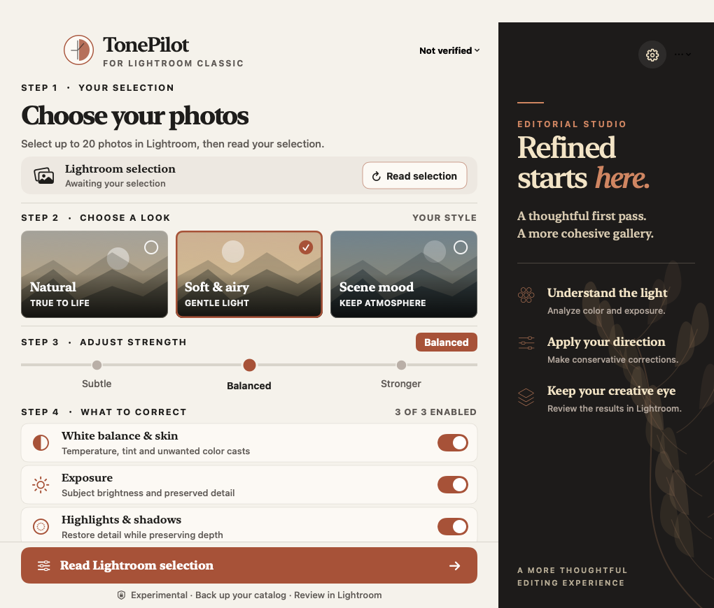
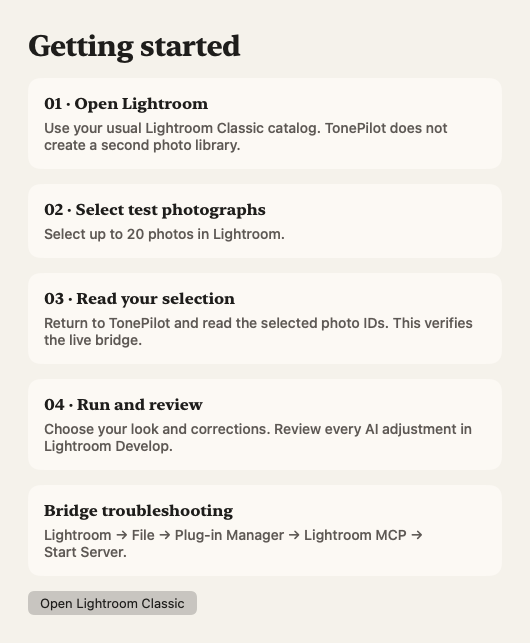

# TonePilot

### You shouldn't have to fix the same photo problem 200 times.

**An AI-assisted first-pass companion for portrait, family, wedding, and event photographers who work in Adobe Lightroom Classic.**

Your clients want beautiful skin tones, consistent color, and photographs that feel like they belong together. You want to spend your time creating that experience—not correcting the same exposure and white-balance problems, frame after frame.

**TonePilot is being built to take the repetitive first pass off your plate. You keep the creative decisions, and you keep working in Lightroom.**

> [!IMPORTANT]
> **Early prototype · v0.3 · Not production-ready.** The native Mac app builds and launches, and the Codex/Lightroom orchestration is implemented. **A complete AI analysis → Lightroom Develop edit → verification cycle has not been validated yet.** Please use test photos and a backed-up catalog only. Time savings and edit accuracy have **not** been benchmarked.

## A closer look

These are **real screenshots of TonePilot's v0.3 Editorial Studio macOS interface**, not AI-generated mockups. The layout combines a warm, light control surface with a charcoal editorial side panel, larger typography, custom editing looks, and restrained controls. The three landscape cards are decorative vector illustrations—not photographs or processed-image previews. The connection is intentionally shown as unverified because live Lightroom editing has not yet been validated.

<table>
<tr>
<td width="50%" valign="top"></td>
<td width="50%" valign="top"></td>
</tr>
<tr><td align="center"><b>Edit</b> · Choose what AI should correct</td><td align="center"><b>Getting started</b> · Stay in Lightroom</td></tr>
</table>

## Who is TonePilot for?

Photographers who **already know how to edit**—and would rather spend less time doing corrections a hundred times.

- **Portrait and family photographers** who want natural, consistent skin tones across changing light.
- **Wedding and event photographers** moving between window light, flash, shade, tungsten, and golden hour.
- **High-volume Lightroom Classic editors** who want a more consistent starting point without handing over their style.

If you love Lightroom but find yourself repeatedly adjusting **Temperature, Tint, Exposure, Highlights, and Shadows** across a gallery, this project is for you.

## The problem we're solving

Presets are useful. But a preset can't always tell the difference between intentional golden-hour warmth, a green cast on someone's skin, and a backlit subject who needs a little more light.

A photograph can look good on its own and still feel noticeably different beside the next frame. Bringing a gallery together takes judgment—and a lot of repetitive work.

**The value proposition:** an AI-assisted starting point that reduces tedious corrections **while leaving the artistic finish and final approval to the photographer.** That's the product goal, not a proven result of v0.1.

## How TonePilot is intended to work

1. **Select your photos in Lightroom.** Stay in your existing catalog. The current pilot is limited to **20 test images**.
2. **Tell TonePilot what matters.** Choose Natural, Soft & Airy, or Scene Mood; select correction strength; enable white balance/skin tone, exposure, and/or tonal adjustments.
3. **Run AI First Pass.** Codex is instructed to inspect Lightroom-rendered previews, identify high-confidence problems, save the existing Develop settings, and apply conservative corrections through Lightroom MCP.
4. **Review where you already work.** Check the results and any flagged exceptions inside Lightroom Classic. TonePilot writes a session report; it does not automatically export your photographs.

**Lightroom is the editor. TonePilot is the assistant.** No second catalog. No competing RAW processor. No duplicate high-resolution photo browser.

## What's available today?

| Capability | Honest status |
| --- | --- |
| Native SwiftUI Editorial Studio and menu-bar entry | **Built and launched** on Apple Silicon |
| Correction preferences for white balance, exposure, and tone | **Implemented** |
| Read-only Lightroom selection scanner | **Implemented**, live bridge response not verified |
| Codex CLI + Lightroom MCP editing orchestration | **Wired**, end-to-end edits not yet validated |
| Limit selection to 20 photos for early testing | **Implemented in the app**, with agent instructions |
| Original-setting baseline, preview-based review, edit report | **Requested by the editing agent**, not independently verified |
| Accurate, consistent color across real photo sessions | **Unproven**; needs tests with RAW galleries |
| Fully local/offline AI processing | **Not included** |
| One-click edits on hundreds of photos | **Not supported yet** |
| Signed and notarized macOS distribution | **Not available** |

The last recorded connection test reported **“Lightroom plugin not connected.”** Getting a real pilot working reliably is the next priority.

## Under the hood

TonePilot does **not** currently include a custom trained editing model or a local LLM.

~~~text
TonePilot (native macOS / SwiftUI)
     │
     ├─ Read-only selection sync ──► Lightroom MCP
     │
     └─ "Run AI First Pass"
              │
              ▼
       Codex CLI (cloud-backed AI)
              │
              ▼
       Lightroom Classic MCP bridge
              │
              ▼
       Adobe Lightroom Classic
       (previews + nondestructive Develop changes)
              │
              ▼
       You review the actual images in Lightroom
~~~

The AI is provided through **your existing authenticated Codex CLI configuration**, not a standalone TonePilot API subscription. Usage, model access, and limits depend on your Codex configuration. Lightroom MCP is an **independent third-party integration** maintained at [Automaat/lightroom-mcp](https://github.com/Automaat/lightroom-mcp).

### Lightweight by design

TonePilot doesn't build a second photo library or constantly render previews in its own window. Lightroom handles photographic rendering. AI analysis is performed when editing is requested.

There will still be resource costs when Codex is active and Lightroom generates previews. Any memory, speed, or time-savings claims need real benchmarks.

## Try the development prototype

> **For developers and testers.** Not an installer for general photographers yet. The current code expects the checkout at the path below and builds the app into your user Applications folder.

**Requirements:** macOS 14+, Apple Silicon (tested on an M4 Mac mini), Lightroom Classic, [Node.js](https://nodejs.org/) 18+, authenticated [Codex CLI](https://github.com/openai/codex), and Xcode Command Line Tools (Swift compiler).

1. Clone and build:

   ~~~bash
   git clone https://github.com/manynames3/TonePilot.git ~/Documents/Lightroom-AI-FirstPass
   cd ~/Documents/Lightroom-AI-FirstPass
   ./TonePilot/build.sh
   open ~/Applications/TonePilot.app
   ~~~

2. Install the [Lightroom MCP plugin](https://github.com/Automaat/lightroom-mcp#install-other-ai-tools), restart Lightroom Classic, then go to **File → Plug-in Manager → Lightroom MCP → Start Server**.
3. Register the Lightroom bridge for Codex if needed:

   ~~~bash
   codex mcp add lightroom -- npx -y @mskalski/lightroom-mcp
   ~~~

4. **Back up the Lightroom catalog.** Select no more than 20 disposable/test images in Lightroom, return to TonePilot, and click **Sync selection**.
5. If the connection is confirmed, select correction types and use **Run AI First Pass**. Inspect every change and Lightroom's Develop History before doing anything else.

**Build note:** the development app is locally **ad-hoc signed, not notarized**. macOS may require user approval on another machine. A portable installer and first-run onboarding are planned.

## Your photos, your control

- **Not offline-only.** Codex may send rendered image previews and relevant metadata to its configured AI service. Confirm you have the necessary consent and review the provider's privacy terms before using client photographs.
- **Back up first.** Lightroom changes are nondestructive but still change catalog editing state.
- **Selection safety is not independently enforced at the MCP tool boundary yet.** The AI is instructed to restrict itself to selected photo IDs, save baseline settings, and avoid unrelated actions; do not mistake these instructions for a hard sandbox.
- **No automatic exporting or publication.** The intended workflow leaves final review and delivery in Lightroom.
- **No production quality guarantee.** This is a research-and-development prototype until actual edit quality and reliability are measured.

## What comes next?

1. **Prove the first pass works:** reliably connect to Lightroom, capture originals, make and verify a small set of actual adjustments.
2. **Prove it helps:** compare corrections against photographer-approved reference edits, especially difficult skin-tone tint and exposure.
3. **Make it safer:** enforce tool permissions, improve error recovery and rollback, and validate before any larger batches.
4. **Refine Editorial Studio:** improve accessible interactions, progress states, and live Lightroom diagnostics. The v0.3 visual redesign is implemented; the editing engine is still experimental.
5. **Make it distributable:** portable paths, onboarding, installer, signing, and notarization.

## About the project

**TonePilot exists for photographers who want their time back without giving up their eye.** It is an independent experiment in turning routine photo corrections into a reliable AI-assisted first pass—inside the Lightroom workflow professionals already trust.

Not affiliated with or endorsed by Adobe or OpenAI. Adobe Lightroom Classic and other names are trademarks of their respective owners.

**License:** no redistribution license has been assigned yet. Public visibility does not by itself grant permission to redistribute or republish this code.
