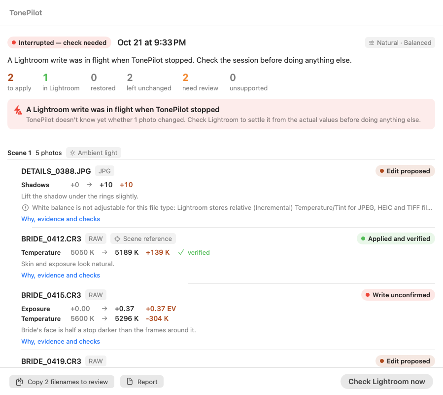

# TonePilot

### A careful, scene-aware first pass for Lightroom Classic.

For portrait, family, wedding and event photographers who already know how to edit and are tired of fixing the same exposure and white-balance drift frame after frame. You select photos in Lightroom; TonePilot groups them into lighting scenes, proposes small corrections that make each scene consistent, and writes only the edits you approve. Lightroom stays your editor.

> [!IMPORTANT]
> **Developer preview · v0.5.0 · not for client work yet.** The safety and recovery engine passes 115 automated tests, including killed processes and a dying Lightroom bridge — all against a simulated Lightroom. In real Lightroom, TonePilot has made 15 Develop writes (12 RAW, 3 HEIC), all verified by read-back, including white-balance corrections on RAW. **Restore on real photos, the test-catalog protocol and a photographic-quality benchmark have not been run yet.** See the [changelog](CHANGELOG.md). Time savings are unmeasured. See [what has actually been measured](docs/EVIDENCE.md).

<table>
<tr>
<td width="50%" valign="top"></td>
<td width="50%" valign="top"></td>
</tr>
<tr><td align="center"><sub><b>Review</b> · every value, reason and approval in one place</sub></td><td align="center"><sub><b>Recovery</b> · an interrupted write is never guessed</sub></td></tr>
</table>

<sub>Screens use synthetic demo data from the test harness, not real photographs.</sub>

## What it does

1. **Reads your Lightroom selection** (up to 20 photos in this version) and saves every photo's original settings before anything else.
2. **Measures each Lightroom preview on your Mac** — faces and skin, highlight headroom, capture time, flash — and **groups photos into lighting scenes**.
3. **Asks an AI model for a judgment** of light, intent, skin cast and subject exposure. The model has no Lightroom access.
4. **Builds a consistent plan per scene**: darker frames are matched to their neighbours by measured face brightness; auto white-balance drift is synced within the same light; deliberate low-key, silhouette and high-key frames are left alone; brightening stops before it clips highlight detail.
5. **You review and approve** each photo — original, proposed and (later) verified values, the reason, and what TonePilot could not judge.
6. **Applies only what you approved**, one photo at a time, re-checking each photo first and reading every value back afterwards.
7. **Restores originals on request** — but never over an edit you made afterwards.

### Editing direction is enforced, not suggested

| | Subtle | Balanced | Stronger |
|---|---|---|---|
| Max exposure change (cumulative across runs) | ±0.35 EV | ±0.6 EV | ±1.0 EV |
| Max white-balance change | ±12 mired (≈ ±350 K daylight) | ±20 mired | ±30 mired |
| Share of each computed correction applied | 60% | 80% | 100% |
| Model confidence needed (uncalibrated) | 88% | 82% | 78% |

**Natural** targets neutral, consistent subjects. **Soft & airy** targets +0.2 EV brighter subjects with lifted shadows and blacks. **True to scene** ignores small corrections and preserves deliberate coloured light. Looks only use controls TonePilot can write: exposure, highlights, shadows, whites, blacks, and (RAW only) temperature and tint.

## Safety you can check

- Analysis never writes. Applying and restoring need explicit confirmation.
- A crash-safe journal records every intended write *before* it happens. After a crash, force-quit or Lightroom closing, TonePilot reopens the affected session and settles it from Lightroom's actual values — it never assumes.
- Photos you edit after analysis are skipped. Restore only reverses TonePilot's own values while they're untouched; your later edits always win.
- Running TonePilot again can't push a photo past one pass's limits.
- Never touched: crop, masks, profiles, HSL, presets, metadata, ratings, export.
- On JPEG, HEIC and TIFF files white balance can't be changed through the Lightroom bridge; TonePilot says so instead of guessing.

## Your photos and privacy

TonePilot sends 640-pixel Lightroom previews and the photo's current Develop values to the AI service behind **your** Codex CLI account. Face and highlight measurements run on your Mac. Make sure you have your clients' consent and accept your AI provider's terms before using client work.

## Try the developer preview

Test photos in a **backed-up, disposable catalog** only. Requirements: macOS 14+, Apple Silicon, Lightroom Classic, the [Lightroom MCP plug-in](https://github.com/Automaat/lightroom-mcp) 0.24.1, Node.js 18+, a signed-in Codex CLI, and the Xcode Command Line Tools to build.

```bash
git clone https://github.com/manynames3/TonePilot.git
cd TonePilot
./TonePilot/build.sh
open ~/Applications/TonePilot.app
```

TonePilot's **Setup** screen checks all of the above and tells you how to fix anything missing. The build is ad-hoc signed and not notarized.

## Status

| Area | State |
|---|---|
| Durable sessions, recovery, verified writes, safe restore | Implemented; tested against a simulated Lightroom with fault injection |
| Real Lightroom read path, measurements, scene grouping, planning | Verified read-only on 5 HEIC photos |
| Real Develop writes | 15 in the owner's catalog, 15/15 verified; restore not yet exercised; test-catalog protocol ([gate G1](docs/VALIDATION.md)) not run |
| White balance | Skin-tone verdict + measured colour-cast correction; verified writes on RAW; HEIC/JPEG need the TonePilot edition of the bridge |
| Multi-scene galleries | **Not yet run** |
| Photographic quality, time saved | **Unmeasured** — blind benchmark harness ready ([gate G3](docs/VALIDATION.md)) |
| Galleries over 20 photos | Not supported until scale gates pass |
| Model consistency | Same photos analyzed twice agreed on 4 of 5 decisions |
| Signed and notarized installer | Scripts ready; not done |

## Documentation

- [Audit of v0.4 and what changed](docs/AUDIT.md)
- [Evidence — real vs simulated vs unmeasured](docs/EVIDENCE.md)
- [Validation gates and protocols](docs/VALIDATION.md)
- [Competitive position and strategy](docs/COMPETITIVE.md)
- [Engine architecture and safety invariants](TonePilot/Engine/README.md)
- [Source, build and tests](TonePilot/README.md)

Not affiliated with or endorsed by Adobe, OpenAI or the Lightroom MCP project. Adobe Lightroom Classic is a trademark of Adobe. **License:** none assigned yet; public visibility does not grant permission to redistribute this code.
